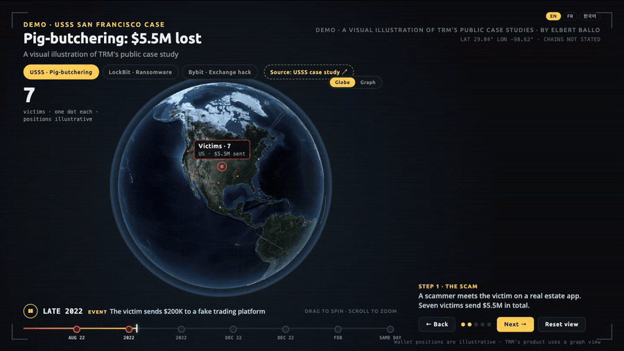

# TRM Globe Demo

An interactive concept demo. It shows how a crypto-crime trace could look as a marketing visual: funds move across a 3D globe, the case reaches an exchange alert, and the case file goes to partner agencies.

Live: https://trm-globe-demo.vercel.app/

[](docs/demo.mp4)

**[Watch the full 50-second demo (MP4)](docs/demo.mp4).** It shows the USSS pig-butchering case on the globe, the "Share with USSS" approval, and then the Bybit hack in the graph view.

> **Concept mock, not a TRM product screen.** I built it as a portfolio piece for a Marketing Technology Engineer interview. TRM's product uses a graph view, so the demo also has a Globe/Graph toggle.

## What is in it

- **3 cases from public sources.** Each case uses only facts that TRM, the US Secret Service, or the press published. Wallet locations are marked "location not public."
  - Pig-butchering: USSS San Francisco case study ($5.5M lost, $5M recovered)
  - Ransomware: TRM's post on the LockBit charges (1,400+ attacks)
  - Exchange hack: TRM's post on the Bybit hack (~$1.5B, North Korea attribution)
- **Auto-play trace** with a scrubbable timeline and a UTC case clock.
- **Clickable pins and SRC tags** that open an evidence card.
- **Globe/Graph toggle.** The graph is a left-to-right trace with the same timing.
- **EN / FR / 한국어** language picker. I did the translations, and a native speaker has not checked them yet.

## Run it locally

Open `index.html` in a browser. It needs no server and no build step.

## Deploy

The Vercel project `trm-globe-demo` deploys this repo. Push to `main` to update the live site.

The site is unlisted. A `noindex` meta tag and an `X-Robots-Tag` header in `vercel.json` keep it out of search results.

## Files

```
index.html                  the whole app (HTML, CSS, JS)
docs/demo.mp4, demo.gif     README demo video (not deployed, see .vercelignore)
*.woff2                     Open Sans and Ubuntu Sans variable fonts
vendor/three.min.js         three.js (MIT)
vendor/topojson-client.min.js
vendor/countries-50m.js     Natural Earth 50m borders (public domain)
vendor/textures.js          NASA Blue Marble and night-lights textures (public domain), as data URIs
```

The textures are embedded as data URIs, so the page also works from `file://`.

## Credits

- Earth imagery: NASA Visible Earth (Blue Marble, Black Marble)
- Borders: Natural Earth
- 3D: three.js
- Case facts: the public TRM Labs, USSS and press sources named in each case's "Real case" card

Built by Elbert Ballo.
